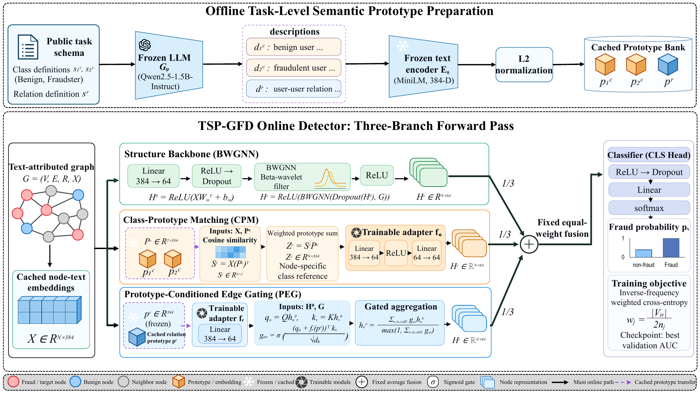

# TSP-GFD Main Experiment

This repository draft contains code and configuration for the main experiment.

## Method overview

TSP-GFD detects fraudulent nodes in text-attributed graphs. It uses a frozen language model and text encoder to build and cache task-level class and relation prototypes offline. The detector combines three branches: a BWGNN backbone for graph structure, class-prototype matching for node-specific semantic features, and prototype-conditioned edge gating for neighbor aggregation. The three outputs are averaged for classification, with no online language model calls.

- models/: TSP-GFD prototype interface and BWGNN implementation.
- scripts/: locally adapted prototype generation and training/evaluation scripts.
- configs/: experimental hyperparameters.
- prompts/: public task definitions and prototype generation prompt.
- splits/: fixed train, validation and test node-index tensors.
- data/: dataset access information.
- research_sources/: main-comparison experimental source scripts, including baseline adapters.

## Preparation

Install the dependencies in requirements.txt using a compatible Python environment. Version compatibility is not yet verified.

Download the CAMERA datasets from their original source, following the provider's licence. Prepare a PyTorch graph dictionary with x (N x 384 encoded node features), edge_index (2 x E), and y (N labels). Node order must match the fixed partition indices.

Generate the prototype cache locally:

    python scripts/prepare_prototypes.py --llm Qwen/Qwen2.5-1.5B-Instruct --encoder sentence-transformers/all-MiniLM-L6-v2 --output local/prototypes.pt

Run the TSP-GFD main model:

    python scripts/train_evaluate.py --dataset reddit --graph local/reddit.pt --prototypes local/prototypes.pt --test

The adapted scripts have not been tested end-to-end. The experimental source scripts require path configuration, data preparation, and upstream baseline dependencies; some entries are retained as source references and are not yet a portable workflow. Check third-party licences before making this repository public.
